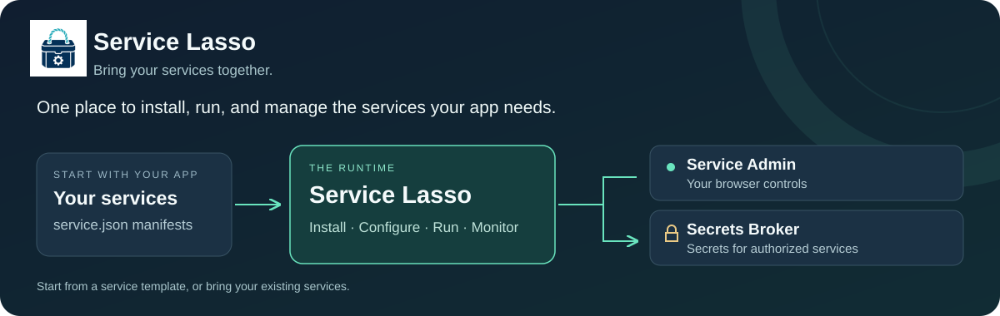

# Service Lasso



[](https://github.com/service-lasso/service-lasso/actions/workflows/docs-site.yml?query=branch%3Adevelop) [](https://nodejs.org/) [](LICENSE)

**Run the services your app needs. Manage them in one place.**

Service Lasso installs, configures, starts, and monitors local services for you. Give it a service manifest; it handles downloads, dependencies, and startup order, with a browser UI to see what's running.

Use it to bring up a local app stack or ship supporting services with a Node, web, or desktop app. Manage native service processes through the UI, CLI, or HTTP API.

## Start the recommended stack from a clone

Install **Node.js 22.12+**, **npm**, and **Git**. Internet access is needed for
service releases on the first start. Core itself does not require Go.

```sh
git clone --single-branch --branch develop https://github.com/service-lasso/service-lasso.git
cd service-lasso
npm ci
npm start
```

Keep this terminal open. This builds Core and uses its owned baseline startup to
install/configure the recommended services from `services/`, with persistent data
in `workspace/`. The API defaults to **http://127.0.0.1:17883** with a fixed port;
a conflicting listener is an error. Startup reports the actual API and service
endpoints. First-use downloads can take several minutes. Unsupported provider
artifacts are explicitly skipped; this is the real managed stack, not a fixture.

Open **[Service Admin](http://127.0.0.1:17700/)** using the reported endpoint if it
was allocated differently. Complete first-run setup and privately save its
credentials and recovery information. Regular services wait for onboarding;
use Admin to install/configure/start remaining services when offered. Once
running, try the [Echo service](http://127.0.0.1:4010/).
[First-run help →](docs/quick-start.md)

From another terminal in the same checkout:

```sh
npm run status
npm stop
npm start
# Or restart the same workspace in one foreground command:
npm restart
```

Ctrl+C in the start terminal also shuts down the owned runtime. Stop/restart use
Core's workspace ownership checks and retain data. Use the same
`SERVICE_LASSO_WORKSPACE_ROOT` (and `SERVICE_LASSO_SERVICES_ROOT` if customized)
for every command. `SERVICE_LASSO_PORT` changes the API port; point clients at that
actual URL. Explicit root flags, for example `npm start -- --port 18080`, also work.
The separate [demo commands](docs/demo/README.md) use their own demo workspace.

## CLI and TUI for that same instance

Core owns services; these are attached operator tools launched when requested.
Install **Go 1.26+** on PATH for their first source build. No sibling clones or
global installs are needed. `npm run operator:setup` optionally builds both ahead
of time; otherwise each command builds its own reviewed tool on first use in
ignored `.operator-tools/`. See [the pinned sources](scripts/source-operator-tools.mjs).
These source builds do not confer packaged release qualification.

For authenticated operation, use the local administrator token saved during
onboarding. In a Bash-compatible terminal, read it privately without placing it
in shell history, then connect both tools to the running Core:

```sh
read -r -s -p "Local admin token: " SERVICE_LASSO_CLI_LOCAL_ADMIN_TOKEN; printf '\n'
export SERVICE_LASSO_CLI_LOCAL_ADMIN_TOKEN
export SERVICE_LASSO_API_TOKEN="$SERVICE_LASSO_CLI_LOCAL_ADMIN_TOKEN"
npm run cli -- --core-url http://127.0.0.1:17883 instance status
npm run tui -- --api http://127.0.0.1:17883
unset SERVICE_LASSO_CLI_LOCAL_ADMIN_TOKEN SERVICE_LASSO_API_TOKEN
```

The TUI requires an attached terminal. Use Arrow keys, Tab and Enter, then `q`
to quit. API/authentication failures stay visible; an open dashboard alone does
not prove a connection. For another configured authentication mode, use its
normal client credential configuration. Never print or commit credentials.

## API-only development alternate

```sh
npm start -- --noautostart
# Or invoke the explicit serve entrypoint with your own port:
npm run serve -- --noautostart --port 18080
```

The opt-out skips service startup for this launch and preserves the saved
startup preference. `npm run dev` retains the development server flow.

## Make it yours

**[Add PostgreSQL and connect an app →](docs/getting-started/intermediate-make-todo-app-durable.md)** · [Let your agent do it →](docs/agent-prompts.md)

- **Bring your services.** Describe how to install and run each one in a `service.json` manifest. [Write a service →](docs/service-authoring/overview.md)
- **Choose ready-made services.** Browse databases, runtimes, proxies, and other services you can add to your app. [Service catalog →](docs/service-catalog.md)
- **Embed the runtime.** Use the npm package or start from a Node, web, Electron, or Tauri reference app. [CLI, API, and npm →](docs/runtime/README.md) · [App templates →](docs/reference-apps.md)

[Demo commands, ports, and troubleshooting →](docs/demo/README.md)

## Go further

| When you need to… | Read |
| --- | --- |
| Run services, check health, logs, recovery, or backups | [Run and manage services](docs/operations/README.md) |
| Create a release-backed service | [Build a service](docs/service-authoring/overview.md) |
| Add Lasso to an application | [Use Service Lasso in your app](docs/integration/README.md) |
| Look up stable contracts | [Technical reference](docs/reference/README.md) |
| Set up access and secret boundaries | [Security and access](docs/security/README.md) |
| Build, test, or contribute | [Contribute and maintain](docs/contributing/README.md) |

Secrets support and validation status: [capability ledger](docs/reference/secrets-capability-ledger.md). Report vulnerabilities privately using [Security Advisories](SECURITY.md).

Apache-2.0 · [License](LICENSE)
