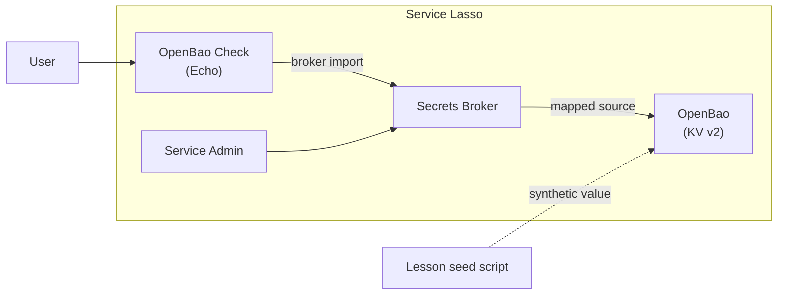

# Advanced - Resolve secrets from OpenBao

The [Todo lessons](README.md) have used the Secrets Broker's local encrypted
store. This lesson adds a second source: a development OpenBao server. The
Broker reads a mapped reference from OpenBao and delivers it to an Echo
consumer at start time.

**Lesson code:** [Complete runnable 07-openbao checkpoint](https://github.com/service-lasso/lesson-todo/tree/develop/lessons/07-openbao).

## Outcome

You run OpenBao and Secrets Broker as managed services, write one KV v2 value
to OpenBao, map the Broker reference `todo/openbao/openbao.DEMO_VALUE` to it,
and start an Echo consumer whose required Broker import resolves through that
source. A checker proves the value reached Echo without printing it.

<div className="tutorial-architecture" aria-label="Resolve a Service Lasso secret from OpenBao">

<p style={{textAlign: 'center'}}><strong>Resolve a secret from OpenBao</strong></p>



</div>

The consumer declares the reference in `broker.imports` and maps it into
`ECHO_OPENBAO_SECRET`. Core resolves the required import before it starts the
consumer. The secret value is materialized only in the consumer's process
environment; it is not written to the lesson repository or the checker output.

## Before you start

You need:

- A working Service Lasso learning host with Service Admin. Use the separate
  `.workspace/07-openbao` tree created by the lesson setup.
- Node.js 22 or newer.
- The Broker and OpenBao releases pinned by the lesson inventory. This page
  describes the `07-openbao` checkpoint, not an OpenBao production deployment.

:::warning Development source only
The checkpoint starts OpenBao in development mode with the synthetic root token
`lesson-root` and a loopback HTTP listener. Development mode keeps data in
memory and is not a production security configuration. Do not put real
credentials in it.
:::

## 1. Prepare the checkpoint

From the lesson repository root:

```sh
npm ci
npm run setup -- 07
node lessons/07-openbao/scripts/configure-openbao.mjs .workspace/07-openbao/services
npm run lesson:07
```

`setup` copies the complete service inventory and creates isolated runtime and
registry state. The configure command writes the Broker source registry into
the owned `@secretsbroker` service root before Broker starts. It refuses to
replace an existing registry unless you pass `--force`.

The source registry is:

```json
{
  "sources": [
    {
      "sourceId": "openbao-lesson",
      "kind": "openbao",
      "displayName": "OpenBao lesson",
      "enabled": true,
      "priority": 10,
      "namespaces": ["todo/openbao"],
      "address": "http://127.0.0.1:18200",
      "tokenEnv": "OPENBAO_TOKEN",
      "refs": {
        "todo/openbao/openbao.DEMO_VALUE": {
          "path": "secret/data/todo/demo",
          "field": "value"
        }
      }
    }
  ]
}
```

`refs` maps the full Service Lasso reference to an OpenBao KV v2 path and
field. `tokenEnv` names the environment variable that supplies the OpenBao
token to Broker. The lesson manifest sets that token to the synthetic
development value.

## 2. Start OpenBao and seed the lesson value

Open the Admin URL printed by the lesson host, complete the local Broker
first-run setup, refresh discovery, and install/configure/start `@openbao` if
it is not already running. Its health endpoint is
`http://127.0.0.1:18200/v1/sys/health`.

Then seed the synthetic value:

```sh
node lessons/07-openbao/scripts/seed-openbao.mjs
```

The script writes `secret/data/todo/demo` with field `value`, reads it back, and
prints only a success message. The value never appears in its output.

## 3. Start the consumer

Install, configure and start `openbao-check` in Service Admin. Its manifest
declares the import:

```json
{
  "env": {
    "ECHO_OPENBAO_SECRET": "${openbao.DEMO_VALUE}"
  },
  "broker": {
    "enabled": true,
    "namespace": "services/openbao-check",
    "buckets": [
      { "namespace": "services/openbao-check", "kind": "service" },
      { "namespace": "todo/openbao", "kind": "shared" }
    ],
    "imports": [
      {
        "namespace": "todo/openbao",
        "ref": "openbao.DEMO_VALUE",
        "as": "ECHO_OPENBAO_SECRET",
        "required": true
      }
    ]
  }
}
```

The Broker receives the full reference
`todo/openbao/openbao.DEMO_VALUE`. The OpenBao source claims the
`todo/openbao` namespace and has an exact mapping for that reference. Because
the import is required, Core does not start the consumer if the source is
missing, unavailable, or denies the read.

Copy **openbao-check**'s Service HTTP origin from Admin and run:

```sh
node lessons/07-openbao/scripts/check-openbao.mjs http://127.0.0.1:4011
```

The checker verifies Echo's `/env` response and prints safe metadata such as
`{"outcome":"ready","ref":"todo/openbao/openbao.DEMO_VALUE","source":"openbao","matched":true}`.
It compares the value without printing it.

## 4. Prove fail-closed behavior

Stop OpenBao in Admin and start `openbao-check` again. The required import
cannot resolve, so the consumer must not start. This is the important
difference between an optional fallback and an authoritative source mapping.

Restart OpenBao and run the seed command again; development mode does not
retain its in-memory data across a restart. Then start the consumer and rerun
the checker.

## How the pieces fit

| Part | Role |
| --- | --- |
| `@openbao` | Development OpenBao service with a loopback HTTP listener and KV v2. |
| `@secretsbroker` | Loads the source registry and resolves configured references. |
| `openbao-check` | Echo consumer that requires one Broker import. |
| `seed-openbao.mjs` | Writes and verifies the synthetic OpenBao KV v2 value. |
| `check-openbao.mjs` | Verifies the Broker-delivered value reached Echo. |

The same pattern applies to a real application: map the app's reference to a
KV v2 path, declare the required import in the service manifest, and let Core
resolve it at launch. For production, use persistent OpenBao storage, a scoped
token, and an appropriately protected transport. See the Broker operator
documentation for source TLS trust and token handling.

## Source inventory

- Broker: `service-lasso/lasso-secretsbroker` release `2026.10.5-301b426`.
- OpenBao: `service-lasso/lasso-openbao` release `2026.10.14-398f800`,
  upstream OpenBao `v2.7.1`.
- Echo consumer: `service-lasso/lasso-echoservice` release `2026.4.20-a417abd`.

The full service inventory, source registry, and scripts are in
[`lessons/07-openbao`](https://github.com/service-lasso/lesson-todo/tree/develop/lessons/07-openbao).
