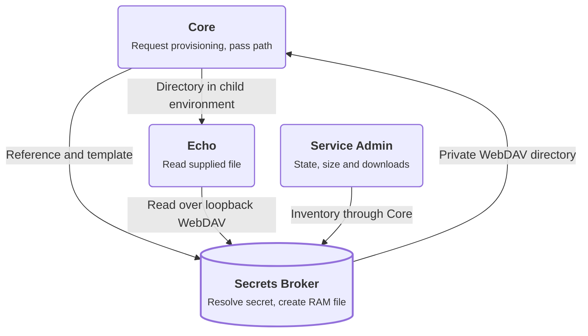

# Advanced — Provision secrets as RAM files

:::info Windows only for now
This lesson is written and checked for **Windows** with PowerShell. Linux and
macOS hosts take a different delivery path; see
[Linux and macOS](#linux-and-macos) at the end before trying it elsewhere.
:::

**Lesson code:** [Complete runnable Echo reference](https://github.com/service-lasso/lasso-echoservice/tree/develop/examples/webdav).

In the [Todo lessons](README.md), services received everything they needed
through environment variables. Some applications insist on reading a credential
from a **file** instead (a `*_FILE` variable, a JSON config, a key file). This
lesson shows how Service Lasso delivers such a file without ever writing the
secret to disk: Secrets Broker creates it in RAM and hands the service a private
path to it.

To keep your Todo stack untouched, the lesson uses a separate learning service,
`echo-webdav`, built from the Echo example. Once you have seen the pattern, the
same `broker` block works for any service whose app can read a file from the
directory it is given.

## Outcome

Secrets Broker provisions a secret into a RAM file and returns a private WebDAV
directory. Core passes that directory to Echo, Echo reads the file, and you
confirm the result with a checker script and Service Admin's **RAM files** view.
You also prove the file is recreated on restart and that launch fails when the
secret is missing.

<div className="tutorial-architecture" aria-label="Provision secrets as RAM files">

<p style={{textAlign: 'center'}}><strong>Provision secrets as RAM files</strong></p>



</div>

The secret value stays inside Broker until Echo downloads the file. Core never
receives the plaintext and never writes it to disk. Delivering secrets through
`env` is still supported separately.

## Before you start

You need:

- A working Service Lasso learning host with Service Admin, for example the
  one from the [Quick start](../quick-start.md). Use a separate services root
  from your Todo checkpoints.
- An initialized and unlocked Secrets Broker, signed in with permission to
  write secrets and to read the workspace inventory.
- **Core built from `develop`.** Broker-provisioned secret files are not in a
  published Core release yet: the latest release, `2026.9.22-f3de461`,
  predates them. Use matching Broker and Service Admin builds that include
  the **Secrets Broker → RAM files** view. Older builds reject or ignore the
  `broker.files` declaration used below.
- Node.js 22 or newer, Git, and the Go version listed in the Echo repository's
  `go.mod`. Go is only needed to build the sample; the built service does not
  need it.

:::caution
Publishing these docs does not upgrade installed binaries. Check the Core,
Broker and Admin builds on your learning host before you start.
:::

## 1. Prepare the service

In PowerShell, from a folder **outside** your host's services root:

```powershell
git clone --branch develop --single-branch https://github.com/service-lasso/lasso-echoservice.git echo-secret-reference
Set-Location echo-secret-reference
$servicesRoot = Read-Host 'Existing services root for your learning host'
node examples/webdav/prepare.mjs $servicesRoot
```

The setup script builds Echo and writes the binary (`echo-secret-demo.exe`)
and a complete `service.json` into a new `echo-webdav` folder in your services
root. It refuses to run if `echo-webdav` already exists, so existing services
are never overwritten. If the build fails, the new folder is left in place for
inspection.

The parts of the generated manifest that matter for this lesson are the `env`
entries that tell Echo where to look, and the `broker` block:

```json
{
  "id": "echo-webdav",
  "executable": "./echo-secret-demo.exe",
  "env": {
    "ECHO_SECRET_FILES_DIR": "${SERVICE_LASSO_SECRETS_DIR}",
    "ECHO_SECRET_FILE_NAME": "demo-config.json"
  },
  "broker": {
    "imports": [
      {
        "namespace": "shared/echo",
        "ref": "echo.DEMO_CREDENTIAL",
        "required": true
      }
    ],
    "files": [
      {
        "path": "demo-config.json",
        "content": "{\"demoCredential\":\"${echo.DEMO_CREDENTIAL}\"}"
      }
    ]
  }
}
```

The full manifest, with endpoints and health checks, is
[`examples/webdav/service.json`](https://github.com/service-lasso/lasso-echoservice/blob/develop/examples/webdav/service.json).
On Windows the setup script only changes the executable name to add `.exe`.

What each part does:

| Configuration | Meaning |
| --- | --- |
| `broker.imports[].namespace` and `ref` | The stored secret this service may use. |
| `required: true` | Broker must find and authorize this secret, or the service does not start. |
| `broker.files[]` | Ask Broker to create the named file in RAM. |
| `path` | The file name inside the private Broker directory, not a disk location. |
| `content` | A template with no secret in it; Broker fills in `${echo.DEMO_CREDENTIAL}` itself. |
| `${SERVICE_LASSO_SECRETS_DIR}` | The private WebDAV directory Broker returns at launch. |
| `ECHO_SECRET_FILE_NAME` | Echo appends `demo-config.json` to that directory and reads it. |

An import on its own does not create a file; the `broker.files` entry does.
Variable names such as `ECHO_SECRET_FILES_DIR` or `*_FILE` are conventions of
the consuming app, so use whatever your app understands.

:::tip
- For a single-value file, use `${database.PASSWORD}` as the whole `content`
  and pass `${SERVICE_LASSO_SECRETS_DIR}/password` to your app.
- Packaged services can ship secret-free template files with
  `broker.templates[]` (`{ source, target }`) instead of inline `content`.
- Broker substitutes text and does not JSON-escape values. The lesson value is
  JSON-safe; put arbitrary raw credentials in a single-value file.
- Ordinary, non-secret configuration still belongs in `config.files`, which is
  written beneath the service root.
:::

:::note Migrating older manifests
Older manifests that declared secret files under `config` with an `ephemeral`
flag are rejected. Move the whole entry into `broker.files` (or
`broker.templates`) and remove the `ephemeral` flag.
:::

## 2. Create the demo secret in Broker

In Service Admin, open **Secrets Broker** and create a secret with:

- namespace `shared/echo`
- ref `echo.DEMO_CREDENTIAL`
- value `synthetic-demo-credential`

The full stored reference is `shared/echo/echo.DEMO_CREDENTIAL`. Use this
synthetic value for the lesson. Real credentials belong in Broker, never in a
checked-in manifest.

## 3. Start through Core

In Service Admin, refresh discovery, then **Install**, **Configure** and
**Start** `echo-webdav`. No manual manifest editing is needed.

When you press **Start**:

1. Core sends Broker the file names, the secret-free templates and the
   allowed references, under a launch lease scoped to this service.
2. Broker checks permissions, resolves the secret, creates the file in RAM
   and returns a private WebDAV directory.
3. Core puts that directory in Echo's environment and starts Echo. The
   secret value never passes through Core.
4. Echo reads and validates the JSON, and reports only safe status.

On Windows the directory arrives as a UNC path. Echo converts it to a loopback
HTTP URL, so you do not need to map a drive or enable the WebClient service.

:::caution
Starting the Echo binary directly does not work: only a start through Core asks
Broker to provision the file.
:::

## 4. Run the checker and inspect usage

In Service Admin, open **Network** and copy Echo's **Service HTTP** origin. It
looks like `http://127.0.0.1:PORT`; use the port actually allocated, which is
not always 4010. Then, from the `echo-secret-reference` folder:

```powershell
$echoOrigin = Read-Host 'Echo Service HTTP origin, for example http://127.0.0.1:4010'
node examples/webdav/check.mjs $echoOrigin
```

On a freshly started instance with the lesson value, it prints:

```json
{ "status": "loaded", "sizeBytes": 46, "reads": 2 }
```

`sizeBytes` is the length of `{"demoCredential":"synthetic-demo-credential"}`.
`reads` counts how often Echo has read the file: once when it started, plus
once more because the checker asks Echo to reread it. The checker fails unless
that count goes up by exactly one, which proves Echo really fetched the file
again rather than reporting a cached result.

You can query the same status yourself. `GET /secret-file` returns status
only; `POST /secret-file` makes Echo reread the file:

```powershell
Invoke-WebRequest -Uri "$echoOrigin/secret-file" -UseBasicParsing | Select-Object -ExpandProperty Content
Invoke-WebRequest -Uri "$echoOrigin/secret-file" -Method Post -UseBasicParsing | Select-Object -ExpandProperty Content
```

The checker exits with an error if the file is unavailable, the origin is not
loopback, the request is redirected, the status is invalid or the counter does
not advance. A healthy Echo alone does not prove the file was delivered.

Now open **Secrets Broker → RAM files** in Service Admin, filter on
`echo-webdav` and select **Refresh files**. You see listener state, RAM use,
the owning service, file size, completed downloads, bytes served and last
access. `demo-config.json` should show the same 46 bytes and two completed
downloads, matching Echo's `reads`, if nothing else read it. Run the checker
again and both numbers go up.

:::note
Directory listings and `HEAD` requests do not count as downloads. The page also
refreshes every 30 seconds, and search and sort apply to the current page only.
File contents and access tokens are never shown.
:::

## 5. Verify recreation and failure

1. In Service Admin, **Stop** `echo-webdav`. Its entry disappears from
   **Secrets Broker → RAM files**.
2. **Start** it again. Broker creates a fresh file at a new path from the
   current secret value, and the counters start again from zero.
3. **Stop** `echo-webdav`. In **Secrets Broker**, delete only the synthetic
   `shared/echo/echo.DEMO_CREDENTIAL` secret, then try **Start**. Launch must
   fail before Echo starts, because the import is `required`. Recreate the
   secret from step 2 and start again to recover. Do not touch real
   application secrets.

Good to know:

- Replacing the file invalidates the old path.
- Restarting Broker loses all RAM files; the next fresh launch provisions
  them again. Processes that are already running keep their existing access.
- A Core crash on its own does not revoke files Broker is still serving. If a
  revoke fails because Broker is unreachable, bring Broker back and retry the
  pending action.
- Recreating a file does not rotate the stored secret.

## Troubleshooting

| Symptom | Check |
| --- | --- |
| Setup refuses the folder | `echo-webdav` already exists. Keep it, or use a separate learning host or services root. |
| Start fails before Echo launches | Broker is unlocked; the namespace and ref exist and are allowed; file names are relative; Broker has RAM to spare. There is no fallback to disk. |
| Echo reports the file unavailable | Echo's environment entries, that the binary came from `prepare.mjs`, and that the template produces valid JSON. |
| **RAM files** is empty | Start `echo-webdav` through Core. Imports used only in `env` do not create files. |
| **RAM files** denies access | Your account has workspace-read permission and Core, Broker and Admin are matching builds. |
| Another app rejects the path | The app must accept a Windows UNC path or an HTTP/WebDAV URL. |

:::caution
File paths are credentials, even on loopback. Share only safe metadata (status,
size, counts) in screenshots and support requests. Remember that an app can
still copy or log the bytes it receives.
:::

## Linux and macOS

This lesson has not been written up for Linux or macOS yet. On those hosts
Broker returns an HTTP directory instead of a UNC path, and apps that need a
native file path require the explicit
[Linux tmpfs alternative](../reference/linux-app-secret-files.md). The
[Echo example README](https://github.com/service-lasso/lasso-echoservice/tree/develop/examples/webdav)
lists the equivalent commands.

## Next steps

- [Complete runnable Echo reference](https://github.com/service-lasso/lasso-echoservice/tree/develop/examples/webdav)
- [service.json reference](../reference/service-json-reference.md)
- [Startup secret resolution](../reference/startup-broker-resolution.md)
- [RAM WebDAV secret files](../reference/ram-webdav-secret-files-review.md)
- Back to the [Getting started](README.md) path
