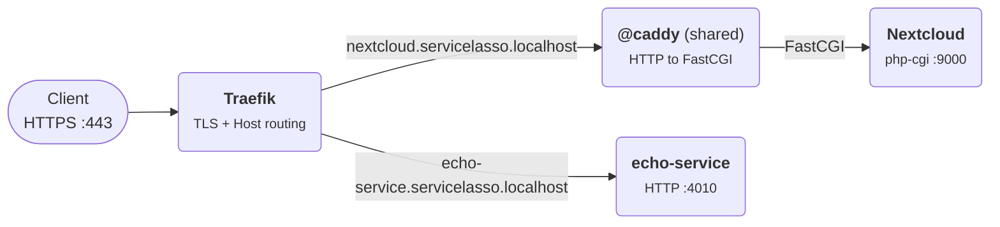

# Advanced - Proxying services with Caddy

Traefik is Service Lasso's public edge: it terminates HTTPS and routes by
domain. That works for HTTP backends, but not for applications that only speak
FastCGI (for example a PHP app such as Nextcloud). This lesson adds the core
`@caddy` service as a shared **HTTP-to-FastCGI translator** behind Traefik.

You will declare an `ingress` block on a service, let Service Lasso register it
with the shared Caddy instance, and then reach the same service both directly
and through the edge.

## Outcome

**Stage: publish a backend through the edge.** A FastCGI or HTTP service stays
private on loopback, while its domain is served by Traefik (TLS) and, for
FastCGI backends, translated by `@caddy`. The service is still reachable
directly on its own endpoint.

<div className="tutorial-architecture">



</div>

Two paths:

- **FastCGI services** (`nextcloud`): Traefik terminates TLS and forwards the
  domain to the shared `@caddy`, which translates HTTP to the FastCGI upstream.
- **HTTP services** (`echo-service`): Traefik routes the domain straight to the
  service endpoint; Caddy is not in the path.

## What `ingress` means

`ingress` does not replace `endpoints`. It references one:

- `endpoints[]` is where the service listens (the upstream).
- `ingress[]` is how that listener is published through the edge.

`domain` is consumed by Traefik for host routing and TLS, and by Caddy for host
matching. `proxy` is consumed by Caddy.

```json
"ingress": [
  {
    "domain": "nextcloud.servicelasso.localhost",
    "proxy": {
      "type": "fastcgi",
      "endpoint": "fastcgi",
      "root": "${NEXTCLOUD_SOURCE_DIR}"
    }
  }
]
```

`proxy` fields:

| Field | Meaning |
| --- | --- |
| `type` | `fastcgi` or `http`. |
| `endpoint` | The network endpoint id whose resolved `bind:port` is the upstream. |
| `root` | Document root. Required for `fastcgi`; omitted for `http`. |

An HTTP service needs only the endpoint:

```json
"ingress": [
  {
    "domain": "echo-service.servicelasso.localhost",
    "proxy": {
      "type": "http",
      "endpoint": "service"
    }
  }
]
```

## 1. Add the shared Caddy service

`@caddy` is not in the default baseline. Add it to the inventory when you need
FastCGI proxying:

```powershell
# a consuming app copies the manifest into its own services inventory
services/@caddy/service.json
```

It exposes two loopback endpoints:

- `web` (preferred `8080`) - the listener Traefik forwards to.
- `admin` (preferred `2019`) - the Service Lasso admin API.

Caddy runs with `automatic_https` disabled: Traefik owns TLS, so Caddy never
provisions certificates or redirects to HTTPS.

## 2. Declare ingress on the backend

For a FastCGI backend, declare the endpoint and the ingress together:

```json
"endpoints": [
  {
    "id": "fastcgi",
    "kind": "network",
    "direction": "inbound",
    "transport": "tcp",
    "protocol": "tcp",
    "bind": "127.0.0.1",
    "port": { "default": 9000, "strategy": "preferred" },
    "exposure": "local",
    "required": true,
    "primary": true
  }
],
"ingress": [
  {
    "domain": "nextcloud.servicelasso.localhost",
    "proxy": {
      "type": "fastcgi",
      "endpoint": "fastcgi",
      "root": "${NEXTCLOUD_SOURCE_DIR}"
    }
  }
]
```

For an HTTP backend, use `type: "http"` and no `root`.

A service can publish more than one route by adding more `ingress` entries.
Each entry becomes its own registration.

## 3. Start the service

When the service starts and becomes ready, Service Lasso:

1. Resolves the `proxy.endpoint` to its allocated `bind:port` (the upstream).
2. Registers a host-matched route with the shared `@caddy` admin API using
   Caddy's own `CADDY_HTTP_PORT` (all services share one listener).
3. Leaves the service listening on its private endpoint for direct access.

The register call is the same contract the Caddy plugin exposes:

```http
POST http://${CADDY_ADMIN_ADDR}/service-lasso/register
{
  "id": "@nextcloud",
  "domain": "nextcloud.servicelasso.localhost",
  "ingress_port": 8080,
  "type": "fastcgi",
  "target": "127.0.0.1:9000",
  "root": "/absolute/path/to/nextcloud"
}
```

Stopping the service calls `POST /service-lasso/unregister` for each registered
route. Registration is best-effort: if `@caddy` is not installed or reachable,
the service still starts and stops normally.

## 4. Verify both paths

- Direct: `http://127.0.0.1:<service endpoint port>/`
- Through the edge: `https://<domain>/` (Traefik terminates TLS), or
  `http://127.0.0.1:<CADDY_HTTP_PORT>/` with `Host: <domain>` during local
  testing.

For Nextcloud, `GET /status.php` through the domain should return
`{"installed":true,...}` once the PHP backend is ready.

## Notes and limitations

- `@caddy` is opt-in and shared: every service that declares ingress registers
  into the same instance and listener.
- Caddy is loopback-only and never terminates TLS; Traefik is the only public
  surface.
- A single `ingress` object is accepted for convenience and normalized to an
  array.
- Traefik domain fan-out uses the same `ingress[].domain`; keep domains unique
  per service.

## Related

- [Service catalog](../service-catalog.md)
- [Manifest fields and health checks](../reference/service-json-reference.md)
- [Configure local routing and SSO](../reference/zitadel-consumer-integration.md)
