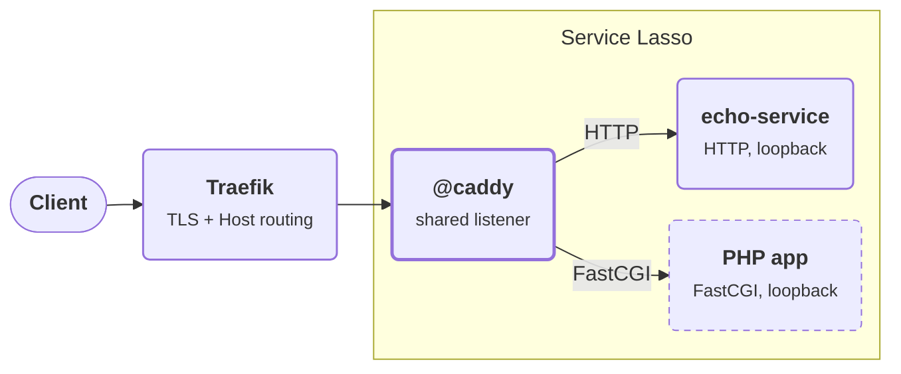

# Advanced — Proxy FastCGI services with Caddy

:::info Windows only for now
This lesson is written and checked for **Windows** with PowerShell. The
`@caddy` service also ships Linux and macOS archives, but those hosts are not
covered here yet.
:::

Traefik is Service Lasso's public edge: it terminates HTTPS and routes by
domain. That works for HTTP backends, but not for applications that only speak
FastCGI, such as PHP apps. The optional `@caddy` service fills that gap as a
shared **HTTP-to-FastCGI translator** that sits behind Traefik.

In this lesson you add `@caddy`, then publish the starter `echo-service`
through it by host name. Echo is a plain HTTP service, which makes it an easy,
dependency-free way to see a route register and work. The same `ingress` block,
with `type: "fastcgi"`, is how you publish a PHP app; the
[complete configuration](#complete-configuration) shows one.

## Outcome

**Stage: publish a backend by host name.** The service stays private on its own
loopback endpoint, and `@caddy` serves it under a domain on a single shared
listener. You can reach Echo both directly and through Caddy.

<div className="tutorial-architecture" aria-label="Proxy FastCGI services with Caddy">

<p style={{textAlign: 'center'}}><strong>Proxy FastCGI services with Caddy</strong></p>



</div>

## Before you start

- Complete the [Todo app](beginner-todo-app.md) lesson, or another setup with
  Service Lasso and Service Admin running from a Core checkout on Windows.
- Make sure `echo-service` is installed. It is part of the default baseline
  and already declares an `ingress` route.
- Know the path of your services root (the folder that holds each service's
  `service.json`).

## What `ingress` means

`ingress` does not replace `endpoints`. It points at one:

- `endpoints[]` is where the service listens (the upstream).
- `ingress[]` is how that listener is published by host name.

This is the route `echo-service` already ships with in
`services/echo-service/service.json`:

```json
"ingress": [
  {
    "domain": "echo-service.servicelasso.localhost",
    "proxy": {
      "type": "http",
      "endpoint": "service"
    }
  }
]
```

`proxy` fields:

| Field | Meaning |
| --- | --- |
| `type` | `fastcgi` or `http`. |
| `endpoint` | The network endpoint id whose allocated `bind:port` is the upstream. If omitted, Core uses `fastcgi` for FastCGI routes and `web` for HTTP routes. |
| `root` | Document root. Required for `fastcgi`; not used for `http`. |

If `domain` is omitted, Core uses the service id plus
`.servicelasso.localhost` (a leading `@` is dropped).

## 1. Add the shared Caddy service

`@caddy` is not in the default baseline. Its manifest lives in the Core
repository at `services/@caddy/service.json`. Copy that folder into your
services root, replacing `YOUR_SERVICES_ROOT` with your own path:

```powershell
$coreCheckout = 'C:\path\to\service-lasso'
$servicesRoot = 'YOUR_SERVICES_ROOT'
Copy-Item -Recurse -LiteralPath (Join-Path $coreCheckout 'services\@caddy') -Destination $servicesRoot
```

In Service Admin, refresh discovery, then **Install**, **Configure** and
**Start** `@caddy`. Install downloads the pinned `lasso-caddy` release
archive; Configure writes `runtime\caddy.json`.

`@caddy` has two loopback endpoints:

- `web` (preferred port `8080`): the shared listener every route is served on.
- `admin` (preferred port `2019`): **Caddy's admin API**, extended by the
  `lasso-caddy` build with the `/service-lasso/register` and
  `/service-lasso/unregister` routes that Core calls.

Both ports are only preferences. If 8080 or 2019 is taken, Service Lasso
allocates another port. Check the actual values on the `@caddy` page or in
**Network** in Service Admin. Caddy runs with automatic HTTPS disabled: Traefik
owns TLS, so Caddy never requests certificates or redirects to HTTPS.

## 2. Register Echo's route

Routes are registered when a service **starts**, so start `@caddy` first. In
Service Admin, **Restart** `echo-service` (or **Start** it if it is stopped).

On start, Core:

1. Reads the `@caddy` admin address (`CADDY_ADMIN_ADDR`) and listener port
   (`CADDY_HTTP_PORT`) from the global variables `@caddy` publishes.
2. Resolves `proxy.endpoint` to the service's allocated `bind:port`.
3. Posts a route to Caddy's admin API. `ingress_port` is the actual
   `CADDY_HTTP_PORT`, which is 8080 only when that port was free.

For Echo, the request looks like this (ports shown are the preferred
defaults):

```http
POST http://127.0.0.1:2019/service-lasso/register
Content-Type: application/json

{
  "id": "echo-service",
  "domain": "echo-service.servicelasso.localhost",
  "ingress_port": 8080,
  "type": "http",
  "target": "127.0.0.1:4010"
}
```

Stopping the service posts `/service-lasso/unregister` with the same `id`.
Registration is best-effort: if `@caddy` is not installed or reachable, the
service still starts and stops normally, and Core logs a warning instead.

## 3. Verify both paths

Fill in the ports Service Admin shows for `echo-service` (**Service HTTP**) and
`@caddy` (**Web**):

```powershell
$echoPort  = 4010
$caddyPort = 8080

# Direct to Echo
Invoke-WebRequest -Uri "http://127.0.0.1:$echoPort/" -UseBasicParsing

# Caddy's own health route
Invoke-WebRequest -Uri "http://127.0.0.1:$caddyPort/health" -UseBasicParsing

# Through Caddy, matched by host name
Invoke-WebRequest -Uri "http://127.0.0.1:$caddyPort/" -Headers @{ Host = 'echo-service.servicelasso.localhost' } -UseBasicParsing
```

**Pass:** the health route returns `ok`, and the direct request and the
host-matched request through Caddy both return Echo's response with status 200.
Stop `echo-service` and repeat the last request: the route is gone.

## 4. Apply it to your own services

To publish another HTTP service, such as the Todo app, add an `ingress` entry
that points at its HTTP endpoint id, then restart it:

```json
"ingress": [
  {
    "domain": "todo.servicelasso.localhost",
    "proxy": { "type": "http", "endpoint": "YOUR_ENDPOINT_ID" }
  }
]
```

For a FastCGI backend, declare a FastCGI endpoint and a `root`. A service can
publish more than one route by adding more `ingress` entries; each becomes its
own registration. Keep every domain unique.

## Complete configuration

### Generated `runtime\caddy.json`

Configure writes this file, with the `web` and `admin` ports actually allocated
(defaults shown):

```json
{
  "admin": { "listen": "127.0.0.1:2019" },
  "apps": {
    "http": {
      "servers": {
        "lasso_ingress": {
          "listen": ["127.0.0.1:8080"],
          "automatic_https": { "disable": true },
          "routes": [
            {
              "@id": "lasso:health",
              "match": [{ "path": ["/health"] }],
              "handle": [{ "handler": "static_response", "body": "ok" }]
            }
          ]
        }
      }
    }
  }
}
```

### `@caddy` manifest wiring

The parts of `services/@caddy/service.json` that Core relies on. The same
variables are also published in `globalenv`, which is how other services'
registrations find them:

```json
{
  "id": "@caddy",
  "endpoints": [
    {
      "id": "web",
      "kind": "network",
      "bind": "127.0.0.1",
      "protocol": "http",
      "port": { "default": 8080, "strategy": "preferred" }
    },
    {
      "id": "admin",
      "kind": "network",
      "bind": "127.0.0.1",
      "protocol": "http",
      "port": { "default": 2019, "strategy": "preferred" }
    }
  ],
  "commandline": {
    "win32": " run --config \"${SERVICE_ROOT}\\runtime\\caddy.json\""
  },
  "globalenv": {
    "CADDY_HTTP_PORT": "${endpoint.web.port}",
    "CADDY_ADMIN_PORT": "${endpoint.admin.port}",
    "CADDY_ADMIN_ADDR": "${endpoint.admin.bind}:${endpoint.admin.port}"
  }
}
```

### FastCGI app manifest

A PHP app published through Caddy over FastCGI:

```json
{
  "id": "wordpress",
  "name": "WordPress",
  "description": "PHP app served through the shared Caddy translator.",
  "version": "6.8",
  "enabled": true,
  "depend_on": ["php"],
  "requires": { "php": ">=8.3" },
  "endpoints": [
    {
      "id": "fastcgi",
      "kind": "network",
      "direction": "inbound",
      "transport": "tcp",
      "protocol": "tcp",
      "bind": "127.0.0.1",
      "port": { "default": 9000, "strategy": "preferred" },
      "exposure": "local",
      "required": true,
      "primary": true
    }
  ],
  "ingress": [
    {
      "domain": "wordpress.servicelasso.localhost",
      "proxy": {
        "type": "fastcgi",
        "endpoint": "fastcgi",
        "root": "${SERVICE_ROOT}/runtime/www"
      }
    }
  ]
}
```

`requires` resolves `php` to the installed PHP provider
(`provides: { "php": "8.3.32" }`); `depend_on` pins that provider.

## Troubleshooting

| Symptom | Check |
| --- | --- |
| Request through Caddy does not reach Echo | The service started before `@caddy` was running, so nothing was registered. Restart the service. |
| Core log shows `@caddy ingress registration skipped` | The message gives the reason: `@caddy` unreachable, a FastCGI route without `root`, or an invalid port. |
| Nothing registers and no warning appears | `CADDY_ADMIN_ADDR` or `CADDY_HTTP_PORT` is not set. Make sure `@caddy` is installed and configured, then restart the service. A route whose `proxy.endpoint` has no allocated port is also skipped silently. |
| Requests to port 8080 fail | `@caddy` may have been allocated a different `web` port. Use the port shown in Service Admin. |
| `${...}` in `domain` or `root` is not replaced | These values are resolved from global variables only, not from the service's own `env`. |

## Notes and limitations

- `@caddy` is opt-in and shared: every service that declares `ingress`
  registers into the same instance and listener.
- Caddy listens on loopback only and never terminates TLS; Traefik is the only
  public surface.
- A single `ingress` object is accepted and normalized to an array.

## Related

- [Service catalog](../service-catalog.md)
- [Manifest fields and health checks](../reference/service-json-reference.md)
- [Configure local routing and SSO](../reference/zitadel-consumer-integration.md)
- Back to the [Getting started](README.md) path
