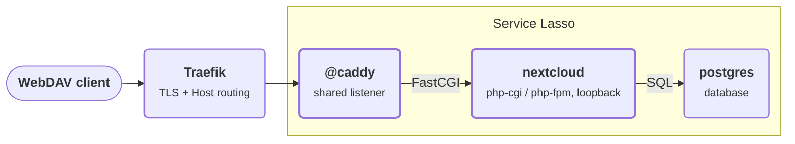

# Advanced — Run Nextcloud behind Caddy

:::info Windows checked
This lesson is written and checked for **Windows** with PowerShell. The
`lasso-nextcloud` package also ships Linux and macOS archives, and the same
Caddy route applies there. The Windows-specific path fix only runs on Windows.
:::

The previous lesson published a tiny PHP page through the shared `@caddy`
translator. Nextcloud is the real thing: a large PHP application, its own data
directory, a database, and WebDAV. It is also a good place to see a Windows-only
failure mode in which a filesystem path walk never reaches `/` and spins after
the file has already been written.

In this lesson you add the release-backed `nextcloud` service, publish it
through `@caddy`, and prove WebDAV with `PUT`, `GET` and `PROPFIND`. Then you
inspect the four Windows compatibility patches that stop the DAV ancestor walk
from looping forever.

## Outcome

**Stage: a real FastCGI application behind the shared translator.** Traefik
stays the public edge. `@caddy` matches `nextcloud.servicelasso.localhost` and
forwards to the private FastCGI endpoint; the `nextcloud` launcher owns PHP and
the Nextcloud install. A WebDAV write returns a response, and the file is
readable back.

<div className="tutorial-architecture" aria-label="Run Nextcloud behind Caddy">

<p style={{textAlign: 'center'}}><strong>Run Nextcloud behind Caddy</strong></p>



</div>

## Before you start

- Complete the [Proxy FastCGI services with Caddy](advanced-proxying-services-with-caddy.md)
  lesson, or another setup with Service Lasso, Service Admin and `@caddy`
  running on Windows.
- Make sure `postgres` is available in your services root.
- Have roughly 400 MB free for the Nextcloud release archive and its extracted
  payload. The first start also creates the Nextcloud database and data
  directory.
- Know your services root (the folder that holds each service's `service.json`).

## What changes compared with lesson 06

Lesson 06 used `php-page`, a tiny static PHP page served by `php-cgi`. Nextcloud
adds three things:

- **A real FastCGI application.** The `nextcloud` launcher runs PHP
  (`php-cgi` on Windows, `php-fpm` on POSIX) and supervises it. The endpoint is
  still a private loopback FastCGI port.
- **A database.** The shipped manifest reads `POSTGRES_*` from the `postgres`
  service and installs Nextcloud with `occ maintenance:install`.
- **A document root that is not a static page.** The Caddy route's `root` is the
  extracted Nextcloud source directory, so `SCRIPT_FILENAME` resolves to
  `index.php`, `remote.php` and the rest of the application.

The route registration is the same mechanism as lesson 06. Only the `proxy`
type (`fastcgi`) and the `root` differ.

## 1. Add the Nextcloud service

The reference lesson ships `lessons/08-nextcloud/services/nextcloud/service.json`.
Copy that folder into your services root, or take the same manifest from the
`service-lasso/lasso-nextcloud` release repository:

```powershell
$lessonServices = 'C:\path\to\lesson-todo\lessons\08-nextcloud\services'
$servicesRoot   = 'YOUR_SERVICES_ROOT'
Copy-Item -Recurse -LiteralPath (Join-Path $lessonServices 'nextcloud') -Destination $servicesRoot
```

In Service Admin, refresh discovery, then **Install**, **Configure** and
**Start** `nextcloud`. Install downloads the pinned
`lasso-nextcloud-34.0.4-*.zip` archive from the latest
`service-lasso/lasso-nextcloud` release. Start extracts it, installs Nextcloud
against `postgres`, writes its configuration, and opens the FastCGI endpoint.

:::note First start is slow
The first start runs `occ maintenance:install` and then the first request
warms the file cache. Give it a minute. Later requests are fast.
:::

## 2. Register the route

Start `@caddy` before `nextcloud` (or restart `nextcloud` after `@caddy`), so
the route exists when Nextcloud starts. On start, Core:

1. Reads `CADDY_ADMIN_ADDR` and `CADDY_HTTP_PORT` from the global variables
   `@caddy` publishes.
2. Resolves `proxy.endpoint` to the allocated `nextcloud` FastCGI `bind:port`.
3. Posts a FastCGI route with the Nextcloud document root.

The registration for this lesson looks like this (ports are the preferred
defaults):

```http
POST http://127.0.0.1:2019/service-lasso/register
Content-Type: application/json

{
  "id": "nextcloud",
  "domain": "nextcloud.servicelasso.localhost",
  "ingress_port": 8080,
  "type": "fastcgi",
  "target": "127.0.0.1:9000",
  "root": "C:\\...\\nextcloud"
}
```

`root` comes from `NEXTCLOUD_SOURCE_DIR`, which the `nextcloud` manifest
publishes in `globalenv` as `${SERVICE_ARTIFACT_ROOT}/nextcloud`. Stopping
`nextcloud` posts `/service-lasso/unregister` with the same `id`.

## 3. Verify WebDAV

Use the `@caddy` **Web** port from Service Admin. The Nextcloud admin
credentials come from the manifest (`admin` / `service-lasso` in this lesson).

```powershell
$caddyPort = 8080
$base      = "http://127.0.0.1:$caddyPort"
$auth      = 'Basic ' + [Convert]::ToBase64String(
  [Text.Encoding]::ASCII.GetBytes('admin:service-lasso'))

$webdav = @{
  Host          = 'nextcloud.servicelasso.localhost'
  Authorization = $auth
}

# Status page through Caddy
Invoke-WebRequest -Uri "$base/status.php" -Headers $webdav -UseBasicParsing

# Write a file over WebDAV
Invoke-WebRequest -Uri "$base/remote.php/dav/files/admin/lesson.txt" `
  -Method PUT -Body 'hello from caddy' -Headers $webdav -UseBasicParsing

# Read it back
Invoke-WebRequest -Uri "$base/remote.php/dav/files/admin/lesson.txt" `
  -Headers $webdav -UseBasicParsing

# List the folder
curl.exe -s -o NUL -w "%{http_code}" -X PROPFIND `
  -H "Host: nextcloud.servicelasso.localhost" `
  -H "Authorization: $auth" -H "Depth: 1" `
  "$base/remote.php/dav/files/admin/"
```

**Pass:** `status.php` returns JSON, `PUT` returns `201`, `GET` returns `200`
with the body you wrote, and `PROPFIND` returns `207`.

The first `PUT` after a fresh install can take several seconds while the file
cache is populated. A second `PUT` to the same folder should complete in under a
second.

## 4. Why Windows needed a path fix

Before the fix, a Windows `PUT` wrote the file, ran every file hook, and then
never returned. The child process stayed at 100% CPU. A dump showed the PHP
interpreter inside `dirname()` called from
`OCA\DAV\Connector\Sabre\Directory::getNodeForPath`.

The cause is the same in four places: the code assumes POSIX paths.

- `dirname('/files/admin/report.txt')` eventually returns `/`, so
  `while (dirname($path) !== '/')` terminates.
- On Windows the same path can become `\files\admin\report.txt`, or a
  drive-qualified path. `dirname()` then returns `.`, `\` or `C:\`, and never
  `/`. The loop never ends.

In the failing request, `View::getFileInfo()` was called **5,601 times in 15
seconds** from the DAV ancestor walk alone. That is the spin.

The fix is a Windows-only guard in four loops. Stop when the parent is `.`, an
empty string, `/`, `\`, a drive root, or when `dirname()` stops making progress:

```php
$parent = dirname($scanPath);
if ($parent === $scanPath
    || $parent === '.'
    || $parent === ''
    || $parent === '/'
    || $parent === '\\'
    || preg_match('/^[A-Za-z]:[\/\\\\]?$/', $parent) === 1) {
    break;
}
$scanPath = $parent;
```

The four patched files are:

| File | Loop |
| --- | --- |
| `apps/dav/lib/Connector/Sabre/Directory.php` | DAV `getNodeForPath()` ancestor read check |
| `lib/private/Files/Mount/Manager.php` | mount lookup by path |
| `lib/private/Files/SetupManager.php` | ancestor setup lookup |
| `lib/private/Files/Config/UserMountCache.php` | cached-mount walk |

They are applied by `lasso-nextcloud/scripts/package.mjs` only when packaging
`win32`, so Linux and macOS keep the upstream code. Packaging fails if the
upstream text no longer matches, so a future Nextcloud bump cannot silently
ship a stale patch.

## Complete configuration

### Nextcloud manifest (abridged)

```json
{
  "id": "nextcloud",
  "version": "34.0.4",
  "endpoints": [
    {
      "id": "fastcgi",
      "kind": "network",
      "direction": "inbound",
      "transport": "tcp",
      "protocol": "tcp",
      "bind": "127.0.0.1",
      "port": { "default": 9000, "strategy": "preferred" },
      "exposure": "local",
      "required": true,
      "primary": true
    }
  ],
  "ingress": [
    {
      "domain": "nextcloud.servicelasso.localhost",
      "proxy": {
        "type": "fastcgi",
        "endpoint": "fastcgi",
        "root": "${NEXTCLOUD_SOURCE_DIR}"
      }
    }
  ],
  "globalenv": {
    "NEXTCLOUD_FASTCGI_HOST": "${endpoint.fastcgi.bind}",
    "NEXTCLOUD_FASTCGI_PORT": "${endpoint.fastcgi.port}",
    "NEXTCLOUD_FASTCGI_ADDR": "${endpoint.fastcgi.bind}:${endpoint.fastcgi.port}",
    "NEXTCLOUD_SOURCE_DIR": "${SERVICE_ARTIFACT_ROOT}/nextcloud"
  },
  "artifact": {
    "kind": "archive",
    "source": {
      "type": "github-release",
      "repo": "service-lasso/lasso-nextcloud",
      "channel": "latest"
    }
  },
  "depend_on": ["@node", "postgres"]
}
```

The shipped production manifest also declares `zitadel` and the `user_oidc`
settings. This lesson sets `NEXTCLOUD_OIDC_ENABLED=false` so the stack is
self-contained; the same FastCGI and Caddy route is unchanged when OIDC is on.

### Windows compatibility patch list (abridged)

```js
const windowsCompatibilityPatches = [
  { file: "lib/private/DB/MigrationService.php", /* separators */ },
  { file: "lib/private/legacy/OC_Util.php", /* drive-qualified data dir */ },
  { file: "lib/private/Files/Storage/Local.php", /* containment */ },
  { file: "apps/dav/lib/Connector/Sabre/Directory.php", /* DAV ancestor walk */ },
  { file: "lib/private/Files/Mount/Manager.php", /* mount lookup */ },
  { file: "lib/private/Files/SetupManager.php", /* ancestor setup */ },
  { file: "lib/private/Files/Config/UserMountCache.php", /* cached mounts */ },
];
```

## Troubleshooting

| Symptom | Check |
| --- | --- |
| `PUT` writes the file but the request never returns | On Windows, confirm the four DAV/mount patches are present in the packaged `Directory.php`, `Manager.php`, `SetupManager.php` and `UserMountCache.php`. |
| Caddy returns `502` for the Nextcloud host | The route was not registered. Start `@caddy` first, then restart `nextcloud`. |
| `status.php` works but WebDAV returns `403` or `404` | Use the admin credentials from the manifest and check the trusted-domain value written by `configure.php`. |
| First `PUT` takes several seconds | Expected after a fresh install; the file cache is warming. A second `PUT` should be fast. |
| Install cannot reach the release | Check outbound access to `github.com` and that the `lasso-nextcloud` release still has the `34.0.4` assets. |
| Nextcloud cannot reach Postgres | Check `POSTGRES_HOST`, `POSTGRES_PORT`, `POSTGRES_USER`, `POSTGRES_PASSWORD` in `globalenv` and that `postgres` is running. |

## Notes and limitations

- The Windows fix is packaging-time, not a runtime toggle. Linux and macOS get
  the upstream code.
- `@caddy` is shared: Nextcloud registers into the same listener as Echo and any
  other `ingress` service.
- Nextcloud is heavy for a lesson. If disk or first-start time is a concern, use
  the `@caddy` + `php-page` checkpoint (lesson 06) to learn the route, and use
  this lesson when you need a real WebDAV application.
- OIDC is optional in this lesson. The production `service-lasso/lasso-nextcloud`
  manifest wires `user_oidc` to Zitadel when `NEXTCLOUD_OIDC_*` is set.

## Related

- Previous: [Proxy FastCGI services with Caddy](advanced-proxying-services-with-caddy.md)
- Deep dive: [The 5,601-scan loop: Porting Nextcloud to Native Windows](../development/nextcloud-windows-fastcgi-deep-dive.md)
- [Nextcloud service repository](https://github.com/service-lasso/lasso-nextcloud)
- [Manifest fields and health checks](../reference/service-json-reference.md)
- Back to the [Getting started](README.md) path
